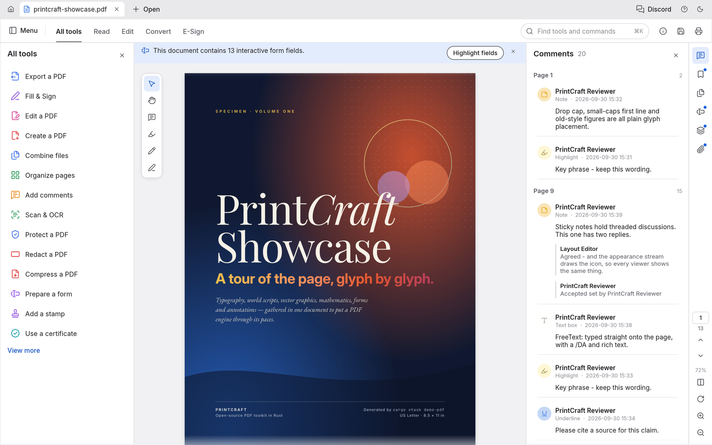

# PdfCraft

**An open-source PDF reader and editor, written in Rust.** Read, search, organize, combine, split, protect and annotate PDFs in a fast native app. No account, no telemetry, no cloud: it works offline.

<p align="center">
  
</p>

## What it does

- **Read** any PDF: world scripts, vertical Japanese, colour emoji, gradients and transparency, with fast scrolling, two-page view, full screen and dark reading colours.
- **Find** text with the find bar (Ctrl+F). With the *Extra keyboard shortcuts* option on (it is on by default), `/` and `?` open a search bar along the bottom that searches forward or backward, with optional regular expressions.
- **Organize** pages like cards: reorder, rotate, delete and extract them, and combine and split files.
- **Protect** with passwords and permissions, open protected files, redact, and check signatures.
- **Comments, forms, layers, attachments and signatures.**
- **Scan and OCR** pages, then check the recognized words before trusting them. The downloads include the OCR models.
- **Script it:** `pdfcraft-cli` handles inspecting, rendering, text, editing, combining and splitting from a terminal. An optional MCP server lets an AI agent drive the same tools (see [docs/mcp.md](docs/mcp.md)).

Ordinary saves append your changes and leave the original bytes untouched.

## Download

Get the latest build from the **Releases** page of this repository:

| System | File | How to run it |
|---|---|---|
| Windows (64-bit) | `pdfcraft-<version>-windows-x64-portable.zip` | Unzip and run `pdfcraft.exe`. There is no installer. The zip also holds `pdfcraft-cli.exe` (the command-line tool) and a `models` folder with the OCR models; keep that folder beside the exes. If SmartScreen warns, choose **More info**, then **Run anyway**. |
| macOS (Apple Silicon) | `pdfcraft-<version>-macos-aarch64.dmg` | Open the disk image and drag PdfCraft to Applications. The OCR models are inside the app. The app is not signed: the first time, **right-click it and choose Open**. |
| macOS command line | `pdfcraft-cli-<version>-macos-aarch64.zip` | The `pdfcraft-cli` tool on its own. |

`SHA256SUMS.txt` on each release lists the checksums. There is no build for Intel Macs, 32-bit Windows or Linux in this repository.

The OCR models are separate files under their own licence (CC-BY-SA-4.0); their licence and credits sit in the same folder.

## Keyboard

Press **F1** in the app for the full list of shortcuts. Beyond the usual ones, **Preferences** has an *Extra keyboard shortcuts* option, on by default, for single-key navigation (`h j k l` to scroll, `g` and `G` for first and last page, `n` and `N` for the next match, `F` to fit the page, and more). **Customize keys…** next to it lets you choose the key for each of those actions.

## Build from source

You need [Rust](https://rustup.rs) 1.95 or later. On Windows you also need the Visual Studio C++ build tools.

```sh
cargo xtask models                              # fetch the OCR models Scan & OCR needs (into assets/models)
cargo run --release -p pdfcraft -- some.pdf     # run the desktop app
cargo build --release -p pdfcraft               # the exe is target/release/pdfcraft.exe
```

On Windows you can double-click `build.bat`: it builds the app and copies `pdfcraft.exe` to `dist\`. The first build takes 10 to 20 minutes.

The GitHub workflow in `.github/workflows/build-and-release.yml` builds the Windows zip and the macOS disk image and publishes them as a release. Start it from the **Actions** tab (Run workflow) with a tag such as `v0.21.2`, or by pushing a version tag.

Developer notes (logs, environment variables, the crate layout) are in [docs/development.md](docs/development.md).

## License and credits

PdfCraft is dual-licensed under the MIT License or the Apache License 2.0, at your option. See [LICENSE](LICENSE). Copyright (c) 2026 ArtCraft Team and the PdfCraft contributors.

Bundled fonts, icons and images keep their own open licenses. Each is listed with its author, source and license in [ATTRIBUTION.md](ATTRIBUTION.md).

The ArtCraft name, wordmark and logos in [`docs/brand/`](docs/brand/) are trademarks of the ArtCraft Team and are not covered by this license. They may be used only unmodified, and only as part of this repository and PdfCraft. Forks and modified versions must remove them.
